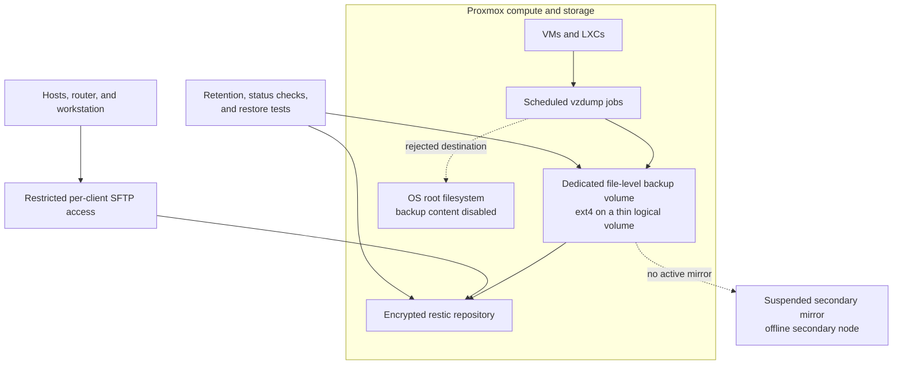

# Backup & Recovery Architecture

- **Status:** Production with explicit residual-risk follow-ups
- **Period:** August 2026–present
- **Scope:** Proxmox guest archives, host/device backups, restricted access, retention, and recovery verification
- **Technologies:** Proxmox VE, vzdump, restic, LVM, ext4, SFTP/SSH, systemd

> Rebuilt a backup system after its own jobs filled the hypervisor root filesystem, then added storage safeguards, encrypted device backups, restricted access, retention, and restore testing.

[Portfolio project](https://jasper.devsnull.net/projects/backup-recovery) · [Incident analysis](incidents.md) · [Verification and residual risk](verification.md) · [Selected implementation artifacts](https://github.com/v0nneumAn/homelab-backup-recovery)

## Executive summary

A scheduled Proxmox backup job targeted the default `local` storage. That sounded like a backup destination, but it was a directory on the hypervisor's root filesystem. Repeated archives filled the root disk, caused incomplete backup runs, and left several guests with stale recovery points.

I rebuilt the architecture around dedicated file-level storage, removed `backup` from root-backed `local`, added a guard against accidentally writing to an unmounted backup volume, and introduced encrypted restic backups for hosts and devices. Access uses restricted SFTP and per-client identities. Retention and pruning run on schedules, while restore tests provide the stronger evidence that the files are useful for recovery.

The current design is operationally useful and restore-tested, but it is **not an offsite disaster-recovery guarantee**. The primary backup repository shares a physical host and storage array with the workloads, and the secondary-node mirror is currently suspended while that node is offline.

### Verified current state

- Hypervisor root filesystem: **29% used**.
- Dedicated backup volume: **24% used**, mounted and active.
- Restic repository: **178 snapshots**, with the latest recorded on **2026-11-26 at 02:30**.
- Daily backup timer: **active**.
- Retention/prune timer: **scheduled** and recently executed.
- Secondary-node storage: **disabled** because that node is intentionally offline.

These checks are read-only status evidence. They are not a substitute for restore testing or offsite resilience.

## 1. The incident: backups filled the system they were meant to protect

### Causal chain

The original design used Proxmox's default `local` storage for weekly guest backups:

```text
weekly vzdump jobs
  → default local storage
  → directory on the hypervisor root filesystem
  → repeated archives consume the OS disk
  → root reaches 100%
  → later jobs fail partway through
```

The root filesystem was 94 GB. A full backup run produced roughly 47 GB of archives, and the storage also held installation images. Two runs were enough to approach the disk's capacity. A later run failed after completing only the smallest guests, leaving several guests with stale archives.

### Why retention did not prevent it

`keep-last=3` sounded like a space bound, but pruning happens **after** a new archive is written for a guest. If the next archive cannot fit alongside the previous one, the job runs out of space before pruning can help.

The issue was therefore not simply “too much backup data.” It was a storage-schema error that allowed backups to share the OS filesystem in the first place.

### The important correction

The permanent fix was not just deleting old archives:

- move backup data to dedicated file-level storage;
- repoint the jobs;
- remove `backup` from the root-backed `local` storage's content list so future misconfiguration fails loudly;
- verify a real archive lands on the new volume without growing the root filesystem;
- add a second guard for the case where the backup volume is not mounted.

## 2. Storage concepts that drove the design

### Proxmox storage is a schema, not just a disk

A Proxmox storage entry controls several independent things:

- **Type:** directory, LVM-thin, NFS, CIFS, ZFS, Ceph, and others;
- **Content:** backup archives, VM disks, ISO images, snippets, and more;
- **Scope:** which nodes may use the storage.

The default `local` entry accepts backup content even though its directory is on the OS root filesystem. The GUI can therefore offer a destination that is valid syntactically but unsafe operationally.

Removing `backup` from that entry turns a silent footgun into an explicit configuration failure.

### File-level versus block-level storage

| Property | File-level storage | Block-level storage |
|---|---|---|
| Stores | Regular files such as backup archives and ISOs | Raw VM/LXC block volumes |
| Can store vzdump archives? | Yes | No, not as ordinary files |
| Has a normal filesystem and directories? | Yes | A thin pool has no ordinary filesystem |
| Suitable for backup repository? | Yes, when deliberately sized and guarded | VM disks, not backup files |

A thin pool cannot simply receive a backup archive as a file. The design therefore created a thin logical volume inside the pool, formatted it with ext4, and mounted it as file-level backup storage. The array could then serve VM block devices and backup files without confusing the two schemas.

### Snapshots are not backups

A snapshot is a point-in-time delta on the same storage as the original disk. It is useful for undoing a change, but it normally shares the original failure domain.

A vzdump archive is a self-contained, portable artifact intended for restoration. Restic adds encrypted, deduplicated, versioned file backups for systems that do not fit the Proxmox guest-backup model.

A restorable disk archive is also not automatically an application-consistent backup of every live database or service. Application quiescing and workload-specific consistency must be evaluated separately.

## 3. Target architecture

The diagram uses roles rather than real hostnames, storage IDs, repository identifiers, or paths.



### Layer 1: Proxmox guest archives

Scheduled vzdump jobs write guest archives to the dedicated file-level volume. The root-backed `local` storage no longer accepts backups, so a future mistake is rejected instead of silently filling root.

The dedicated volume has a mountpoint guard. If it is not mounted, writes must fail rather than landing in an empty directory on root.

### Layer 2: Encrypted host and device backups

Hosts, the router, and the workstation use restic for encrypted, deduplicated, versioned file backups. Clients push through restricted SFTP using dedicated identities and controlled source paths.

The transport is deliberately not a general-purpose interactive shell. Backup access is a constrained service, not unrestricted administrative SSH.

### Operational layer

Retention and pruning limit archive growth, while status checks and restore tests evaluate whether the system produces usable recovery points. A timer being active proves scheduling, not recoverability.

### Secondary copy limitation

The original architecture included a secondary-node mirror. That mirror is suspended while the node is offline, and its storage is currently disabled. There is therefore no active independent second copy in the current design.

## 4. Important decisions and trade-offs

### Dedicated thin LV inside the existing thin pool

**Decision:** create a thin logical volume inside the existing pool, format it with ext4, and use that for file-level backup storage.

**Why:** the pool had no free extents to allocate a separate ordinary volume, and thin pools cannot be shrunk. A thin LV provides file storage without requiring a new array or pretending a thin pool can hold regular files.

**Trade-off:** the backup repository still shares the physical array with VM disks. It separates storage schemas and failure modes around root exhaustion, but not hardware failure.

### Remove backup content from root-backed local storage

**Decision:** treat `local` as unsuitable for backups and remove that content type permanently.

**Why:** deleting old archives only treats the immediate space problem. Removing the content type prevents the same mistake from recurring through a future job or GUI selection.

### Mountpoint trap guard

**Decision:** make the unmounted backup path unwritable and use mount checks in operational scripts.

**Why:** if the backup volume is absent, a directory storage can write into an empty mountpoint on root—the exact original failure mode. A mode-000 underlying mountpoint makes that fail closed.

This is a good example of designing for the failure you have already experienced rather than assuming the mount will always be healthy.

### vzdump for guests, restic for devices

**Decision:** use two backup layers instead of forcing one tool to cover every workload.

**Why:** vzdump understands Proxmox guests and produces restorable disk archives. Restic handles host files, router configuration, and workstation data with encryption, deduplication, and version history.

**Trade-off:** the tools have different consistency, scheduling, and verification requirements. They must be tested as separate layers, not treated as interchangeable files in one directory.

### Restricted SFTP and per-client identities

**Decision:** use dedicated client keys and constrained SFTP access rather than broad administrative SSH.

**Why:** backup clients need a narrow transport, not a general administrative channel. Per-client identities make enrollment, rotation, and revocation manageable and reduce the impact of one compromised client.

The original design also used uniform repository ownership by routing even the host's own backup through the same restricted path. That avoids permission drift between local and remote writers.

### Restore testing over schedule confidence

**Decision:** treat restore tests as a separate acceptance requirement.

**Why:** a completed timer, a snapshot count, and an archive filename only prove that data exists somewhere. Restoration proves that the data can be read and used.

A daily schedule remains useful, but it is not the final acceptance test.

## 5. Implementation sequence

### Phase 0: Create the dedicated volume

The thin LV was created, formatted with ext4, mounted as file-level backup storage, and registered with Proxmox. The unmounted mountpoint was made unwritable to prevent fallback writes to root.

### Phase 1: Move existing archives off root

Existing archives were migrated to the new volume and checked before the originals were removed. Root usage dropped from 100% to 26% during that recovery. It is 29% at the latest read-only check.

### Phase 2: Repoint jobs and reject the old destination

Backup jobs were moved to the dedicated volume, and `backup` was removed from root-backed `local`. A real test archive landed on the new volume without growing root.

### Phase 3: Add restic for devices

An encrypted restic repository was created on the dedicated volume. Devices push over restricted SFTP, including the host itself through the same constrained path to keep repository ownership uniform.

Router configuration is pulled into a controlled staging path and included in the repository rather than depending on a manually remembered copy.

### Phase 4: Apply retention and identity controls

Retention uses daily, weekly, and monthly history with scheduled pruning. Client keys are dedicated per device, and later rotation retained the old local key only until the server enrollment was revoked and the replacement was verified.

### Phase 5: Verify restoration

Restore tests passed for host and device data. Fresh guest archives were also generated after the migration, so completion was based on usable recovery points rather than a storage diagram alone.

### Current status check

The latest read-only check found:

| Check | Evidence |
|---|---|
| Root filesystem | 29% used |
| Dedicated backup volume | 24% used, mounted and active |
| Restic snapshots | 178 total, latest 2026-11-26 02:30 |
| Backup timer | Active |
| Prune timer | Scheduled and recently executed |
| Secondary-node storage | Disabled while that node is offline |

## 6. Outcomes

### The original failure mode is blocked twice

Root-backed `local` no longer accepts backups, and an unmounted backup volume cannot quietly accept writes on root. Both controls are needed because either mistake could recreate the outage.

### Backups became layered and purpose-specific

Guest archives, host files, router configuration, and workstation data have appropriate tools and access models instead of one ambiguous backup directory.

### Access became constrained and revocable

Restricted SFTP and per-client identities reduce the privileges required for routine backups and make key rotation/revocation practical.

### Recovery became an evidence requirement

Restore tests and real archive checks provide stronger confidence than schedules or filenames alone. Current snapshot counts and timer state supplement—not replace—that evidence.

## 7. Residual risk and limitations

### No active offsite copy

The primary repository shares a physical host and array with the workloads. A hypervisor, array, site, or catastrophic administrative failure could affect both production data and backups. The suspended secondary mirror must not be described as active redundancy.

### Physical storage is still a shared failure domain

The thin LV separates storage schemas, not physical disks. It does not protect against array failure, hardware loss, fire, theft, or correlated administrative deletion.

### Restic password availability is critical

An encrypted repository is unrecoverable without its password. Keeping that password in a password manager is a recovery requirement, not an optional convenience.

### Application consistency is workload-specific

A disk archive is not automatically an application-consistent backup of every live database or service. Workload-specific quiescing, dumps, and restore procedures remain separate requirements where needed.

### Scheduled tasks are not restore proof

Active backup and prune timers show that jobs are configured. They do not prove that every archive is complete, every dependency is restorable, or every application can be recovered without additional steps.

### Examples are not a recovery image

The selected public artifacts contain no repository password, private keys, production archives, real repository identifiers, or live storage configuration. They are illustrative implementation evidence, not a restorable copy of the production backup system.

## 8. What this project demonstrates

| Capability | Evidence |
|---|---|
| Failure analysis | Root cause traced through Proxmox storage schema, archive growth, and pruning timing |
| Storage architecture | Dedicated thin-LV file storage, content restrictions, and mountpoint safeguards |
| Backup engineering | Separate vzdump and encrypted restic layers with retention and staging |
| Security | Restricted SFTP, per-client identities, and controlled authorization/rotation |
| Reliability | Restore tests, fresh archives, timer checks, and current snapshot evidence |
| Honest risk assessment | Explicit shared-host, shared-array, consistency, password-availability, and offsite limitations |

## Related documents

- [Incident analysis](incidents.md)
- [Verification and residual risk](verification.md)
- [Selected implementation artifacts](https://github.com/v0nneumAn/homelab-backup-recovery)
- [Homelab case-study index](../../README.md)
- [Portfolio project](https://jasper.devsnull.net/projects/backup-recovery)
