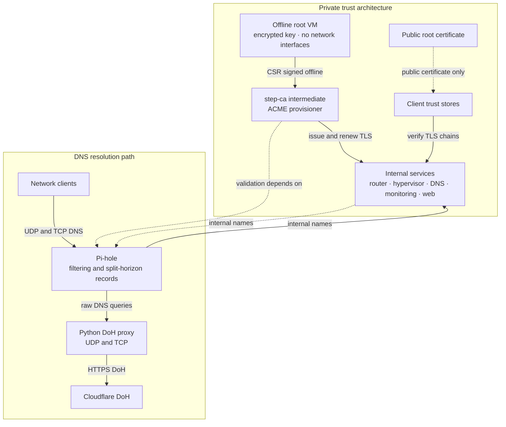
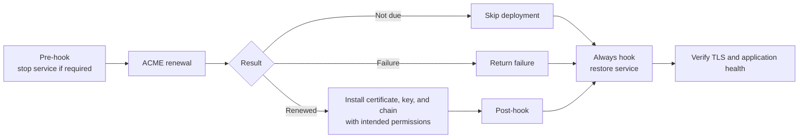

# Internal PKI and DNS Infrastructure

- **Status:** Production
- **Period:** 2026
- **Scope:** Private certificate lifecycle and encrypted internal DNS for self-managed production infrastructure
- **Technologies:** step-ca, ACME, X.509, Proxmox VE, Pi-hole, Python, Docker, Bash, OpenSSL

> Built a two-tier private certificate authority and an encrypted DNS stack that could operate through service failures, certificate renewals, and a later network migration.

[Portfolio project](https://jasper.devsnull.net/projects/internal-pki) · [Incident investigations](incidents.md) · [Verification and limitations](verification.md) · [Selected implementation artifacts](https://github.com/v0nneumAn/dns-ca-stack)

## Executive summary

Internal services need more than IP connectivity. They need names clients can resolve, certificates clients can trust, and renewal behaviour that does not turn a routine lifecycle event into an outage.

I built a private trust architecture around an offline root CA and an online `step-ca` intermediate. ACME automates issuance and renewal across internal routers, hypervisors, DNS, monitoring, and web services. A reusable renewal wrapper guarantees service cleanup even when renewal fails.

Alongside that, I built a DNS path using Pi-hole and a small standard-library Python DNS-over-HTTPS proxy. It provides split-horizon internal names and encrypted upstream resolution while fitting the constraints of rootless, remapped Docker and a DNS startup dependency that made a more conventional Unbound design a poor fit.

The two systems are deliberately documented together because their failure modes intersect: ACME validation depends on DNS, and an unsafe certificate renewal can take down the resolver on which the CA and the rest of the network depends.

### Result

- A root CA private key remains in a VM with **no network interfaces**.
- An online intermediate issues certificates through ACME while running as an unprivileged service user.
- Internal services receive trusted certificates and automated renewal behaviour.
- The DNS path supports UDP and TCP clients, internal names, and encrypted upstream queries.
- Renewal and migration lessons were converted into reusable scripts, checks, and recovery procedures.

## 1. Problem and requirements

### Starting problem

A collection of internal services had three connected needs:

1. **Trust:** browsers and tools should validate internal TLS without treating every service as an unrelated self-signed endpoint.
2. **Lifecycle:** certificates should be issued and renewed automatically, without a failed renewal leaving services stopped.
3. **Resolution:** internal names should resolve only where intended, while external queries should leave the network encrypted.

A single online CA would have made the root key continuously exposed to a network-facing failure domain. A completely manual certificate process would create avoidable operational work and failure opportunities. A conventional recursive DNS design introduced container and bootstrap complexity that was unnecessary for the actual requirement.

### Requirements

I used these requirements to evaluate the design:

- Keep the root private key offline and encrypted.
- Limit the online signing operation to an intermediate CA.
- Use standard ACME rather than a custom certificate protocol.
- Run the CA with least privilege and constrained filesystem access.
- Make service restoration independent of renewal success.
- Support both internal names and encrypted external resolution.
- Avoid privilege requirements that conflict with the existing container model.
- Preserve internal service paths through later address and zone migrations.
- Verify actual TLS chains, DNS responses, and application recovery—not just processes or configuration files.

## 2. Architecture

The diagram uses roles rather than real hostnames, addresses, or network identifiers.

### Trust plane

The root CA exists only to sign the intermediate and future root-level operations. Its private key is passphrase-encrypted and stays inside a VM with no network interfaces. The public root certificate is safe to distribute; the private key is not an artifact for deployment or publication.

The intermediate handles day-to-day issuance. Signing its CSR offline keeps the root isolated while allowing ACME automation for ordinary service certificates.

### DNS plane

Clients query Pi-hole over UDP or TCP. Internal names are answered from split-horizon records. Other queries are forwarded as raw DNS messages to the Python proxy, which sends them to Cloudflare using DNS-over-HTTPS and returns the raw response.

This is not a full recursive resolver. It is a deliberately small forwarding layer for the intended threat model and operational constraints.

## 3. Important decisions and trade-offs

### Two-tier PKI instead of one online CA

**Decision:** create an offline root and an online intermediate.

**Why:** compromise of an online intermediate is easier to contain than compromise of the root. The root can sign a replacement intermediate without making the root key part of normal ACME traffic.

**Cost:** offline signing and transfer require deliberate procedures. The root and intermediate currently share a physical hypervisor as an accepted hardware-consolidation trade-off, so physical-host separation is not as strong as the original placement. That limitation is recorded rather than presented as complete fault isolation.

### ACME instead of manual certificate generation

**Decision:** use the ACME provisioner in `step-ca` for service certificates.

**Why:** ACME gives a standard enrollment and renewal model, reduces repetitive CSR handling, and integrates with existing clients.

**Operational detail:** ACME does not remove the need for careful identifiers, account state, validation listeners, firewall paths, and client trust. Those are part of the implementation rather than automatic behaviour.

### Unprivileged step-ca with constrained systemd state

**Decision:** run `step-ca` as an unprivileged service user with explicit capability and filesystem controls.

**Why:** the intermediate key is sensitive even though the root is offline. The service needs only its configured listen capability, database write path, and application files.

**Verification:** ACME directory access and issuance were tested through real TLS connections rather than assuming the unit's hardening changed application behaviour.

### Reusable renewal wrapper instead of host-specific scripts

**Decision:** put common renewal logic in one wrapper and keep host-specific behaviour in small config files.

**Why:** an earlier `set -e` renewal script could stop a service for standalone validation and then exit before restarting it. Every renewal host now gets the same always-run cleanup semantics.

The lifecycle is:

The wrapper treats the ACME client's “not due” result as success and still runs the always hook. It does not treat an unsuccessful renewal as a reason to leave a service stopped.

### Small DoH proxy instead of Unbound

**Decision:** replace the earlier Unbound design with a standard-library Python DoH forwarder.

**Why:**

- the Unbound entrypoint's privilege-dropping behaviour conflicted with `no-new-privileges` and remapped container users;
- ownership and `chown` behaviour did not fit the container security model;
- Pi-hole could not resolve the DoH endpoint while its own resolver was still starting, creating a bootstrap dependency;
- the requirement was encrypted upstream forwarding, not local recursive resolution.

The proxy binds the DoH hostname to a public resolver address in container configuration so startup does not depend on the DNS service being bootstrapped.

**Trade-off:** upstream DNSSEC validation is delegated to Cloudflare rather than performed locally. This is acceptable for the current threat model, but it is not equivalent to running a validating recursive resolver.

### One internal container network instead of a more elaborate topology

**Decision:** keep the DNS proxy and Pi-hole on a small shared container network.

**Why:** the proxy does not need a public port or added capabilities, and a single network removes avoidable routing and privilege complexity. This follows the same KISS principle as the proxy implementation.

## 4. Implementation sequence

### Phase 1: Create the offline trust anchor

The root VM was created without network interfaces. The root key was generated with passphrase protection, and the root certificate was exported for client trust while the private key remained in place.

This established the main security invariant: normal network services never need the root private key.

### Phase 2: Sign and harden the intermediate

The intermediate CSR was signed by the offline root and installed into `step-ca`. The CA was configured with an ACME provisioner and a hardened systemd unit.

Early validation included an ACME-issued test certificate and verification against the root certificate. This proved the chain and provisioner before onboarding production services.

### Phase 3: Expose only the required CA service path

The intermediate received the service-network path needed by ACME clients while retaining its isolated management design. DNS names and certificate names were updated deliberately rather than relying on a single legacy address.

Client trust was installed per operating system and, where necessary, per browser or device. System trust does not automatically configure every browser trust store.

### Phase 4: Build the DNS path

Pi-hole and the DoH proxy were deployed with:

- a read-only proxy script mount;
- a read-only root filesystem for the proxy;
- all capabilities dropped from the proxy;
- `no-new-privileges`;
- small no-executable tmpfs mounts;
- no public proxy port;
- split-horizon internal records;
- encrypted upstream forwarding over HTTPS.

The result is a small forwarding layer that solves the actual startup and privilege constraints instead of preserving a more complicated resolver design that did not fit them.

### Phase 5: Onboard service certificates

Certificates were issued across internal infrastructure roles including routing, hypervisor management, DNS, monitoring, and web services. Host-specific configs describe pre-hooks, post-hooks, always hooks, and deployment paths, while the wrapper owns shared renewal behaviour.

Operational validation included live certificate chains and real application responses. An application status such as `403` or a redirect can still prove that TLS and the application path were reached; it is not automatically a certificate failure.

### Phase 6: Harden renewal and recovery behaviour

The renewal wrapper became the common path after a renewal failure demonstrated the dependency loop between Pi-hole and ACME. DNS and routing fixes were paired with always-run cleanup, not treated as unrelated changes.

Later migrations added more lessons:

- changing SANs requires fresh issuance rather than assuming `--renew` adopts new identifiers;
- an ACME account's directory location is part of account identity;
- HTTP-01 requires both a reachable listener and an allowed host-firewall path;
- container certificate readability must be checked as the container user, not inferred from host file ownership;
- recovery should restore only missing state rather than overwriting a working configuration.

## 5. Outcomes

### Trust became an internal capability

Internal services now have a coherent certificate chain instead of unrelated self-signed endpoints. The root remains offline while routine issuance stays automated.

### Renewal became safer to operate

The wrapper converts renewal from a service-stopping risk into a controlled lifecycle with cleanup, explicit not-due behaviour, and verifiable application recovery.

### DNS fit the container model instead of fighting it

The proxy provides encrypted upstream DNS without requiring privilege dropping, local recursion, or a startup dependency on Pi-hole itself.

### Troubleshooting became reusable

The project produced concrete methods for diagnosing DNS/ACME dependency loops, asymmetric routes, SAN/account mismatches, validation firewall failures, and application-state recovery. These are recorded in [incidents.md](incidents.md).

## 6. Limitations and follow-ups

- The offline root and online intermediate currently share a physical hypervisor. The root has no network interfaces, but physical-host consolidation remains an accepted trade-off rather than an independent-machine failure boundary.
- The DoH proxy still lacks a dedicated health endpoint and Prometheus metrics. A running container is not presented as a full observability solution.
- Upstream DNSSEC validation is delegated to Cloudflare. This design does not claim local recursive validation.
- Client trust still needs deliberate installation on relevant operating systems, browsers, and devices.
- Public examples in `dns-ca-stack` are derived, sanitised artifacts. They contain no CA private keys, ACME account state, production certificates, or real internal identifiers and are not a recovery image for the production CA.
- The artifact Compose file reflects the inspected deployment's image choices; it is not a newly reviewed, version-pinned production baseline.

## 7. What this project demonstrates

| Capability | Evidence |
|---|---|
| PKI architecture | Offline root, signed intermediate, trust distribution, constrained CA service |
| Protocol automation | ACME enrollment, renewal, SAN/account handling, HTTP-01 validation paths |
| Failure engineering | Always-run cleanup, not-due semantics, selective recovery, service verification |
| DNS and networking | Split-horizon resolution, UDP/TCP forwarding, asymmetric-route diagnosis |
| Container security | Read-only proxy, dropped capabilities, no-new-privileges, controlled tmpfs |
| Operational documentation | Renewal wrapper, example configs, incident records, bounded limitations |

## Related documents

- [Incident investigations](incidents.md)
- [Verification and limitations](verification.md)
- [Selected implementation artifacts](https://github.com/v0nneumAn/dns-ca-stack)
- [Homelab case-study index](../../README.md)
- [Portfolio project](https://jasper.devsnull.net/projects/internal-pki)
