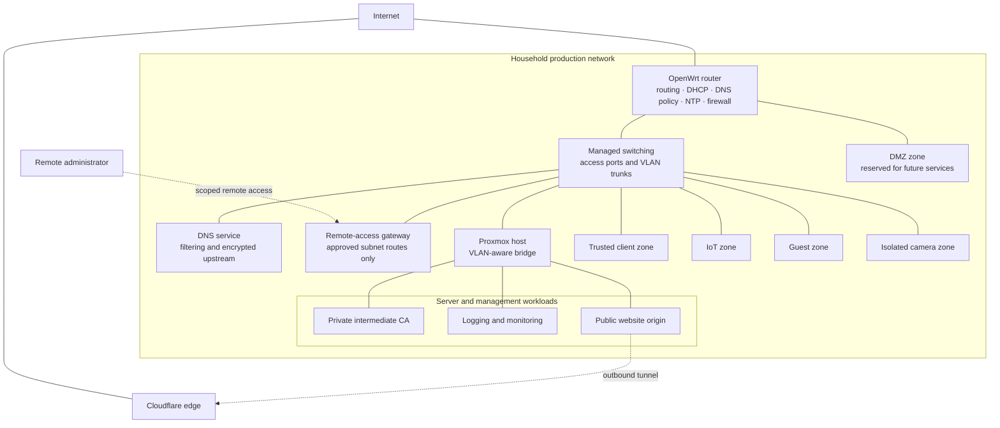
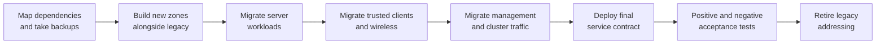

# Production Network Segmentation

- **Status:** Production; migration complete
- **Period:** August–November 2026
- **Scope:** Self-managed household production infrastructure
- **Technologies:** OpenWrt, Cisco IOS XE, Proxmox VE, VLAN/802.1Q, nftables, Pi-hole, Tailscale, ACME

> Rebuilt a flat household network into seven isolated zones while preserving the services, certificates, remote access, and virtualisation platform that depended on it.

[Portfolio project page](https://jasper.devsnull.net/projects/network-segmentation) · [Troubleshooting investigations](troubleshooting.md) · [Verification and acceptance](verification.md)

## Executive summary

The original network placed family devices, servers, management interfaces, IoT equipment, and guests in one broadcast domain. That was easy to administer, but it provided no meaningful trust boundaries. A compromised IoT device could discover and directly contact management systems, and a mistake in one part of the network could affect everything.

I designed and migrated the environment to seven zones: management, servers, trusted clients, IoT, guest, cameras, and a DMZ for future internet-facing services. The work covered switching, routing, DHCP, DNS, NTP, firewall policy, wireless, virtual machine networking, certificates, logging, and remote access as one connected system.

The migration was deliberately incremental. New networks existed alongside the legacy network until their dependencies and client paths were proven. Temporary broad access made staged migration possible, but it was treated as scaffolding and replaced with specific service contracts before the legacy network was removed.

### Final result

- **Seven production zones** with distinct purposes and policy boundaries.
- **Zero hosts found on the legacy subnet** during the final discovery scan.
- **The defined core acceptance checklist passed**, including DNS, NTP, certificate infrastructure, logging, management, public ingress, cluster health, and negative isolation checks.
- **Only explicitly selected networks are remotely accessible** through the remote-access design.
- The physical links and Layer-2 parents required by production remained intact after legacy IP addressing was removed.

“Core acceptance passed” has a bounded meaning: it describes the tests listed in the [verification record](verification.md), not every possible client, inactive zone, or future device.

## 1. Problem and success criteria

### The starting point

A single flat network carried nearly every device and service. Addressing was understandable, but trust and failure domains were effectively shared.

The important problem was not a lack of VLANs as a feature. It was that the network could not express policies such as:

- guests can use the internet but cannot administer infrastructure;
- IoT devices receive required network services without gaining broad access to servers or management;
- only trusted administrators can reach management interfaces;
- monitoring and certificate services can reach their dependencies without opening unrelated paths;
- remote administration works only for intended users, routes, and services.

### Constraints

This was a household production environment, not an isolated lab rack. The design had to account for:

- family devices and services that needed to keep working during migration;
- mixed managed and unmanaged switching;
- access points with different VLAN and wireless capabilities;
- a Proxmox cluster whose management and quorum traffic had to remain healthy;
- internal DNS and certificate dependencies that crossed zone boundaries;
- remote access that could accidentally bypass the path being tested;
- limited maintenance windows and the need to recover from lockout-risk changes.

### Success criteria

I used five practical criteria:

1. **Separation:** each device class has an intended zone and policy boundary.
2. **Service continuity:** required DNS, time, certificate, logging, management, and public-service paths work after each stage.
3. **Least privilege:** broad temporary forwarding is removed and unrelated destinations remain unreachable.
4. **Recoverability:** risky stages have current backups and a tested or executable rollback path.
5. **Evidence:** completion is based on runtime state and real client tests, not configuration files alone.

## 2. Target architecture

The final design uses router-on-a-stick: Layer-2 VLANs carry separate broadcast domains through the switching and virtualisation layers, while OpenWrt routes between them and applies policy.

The diagram is intentionally role-based. It omits real addresses, hostnames, port assignments, and network identifiers.

### Zone responsibilities

| Zone | Intended occupants | Policy intent |
|---|---|---|
| Management | Network administration and hypervisor management | Highly restricted; accessible only through explicit administrative paths |
| Servers | Internal applications and infrastructure services | Reachable only for documented service flows and administration |
| Trusted | Managed personal and family clients | General internet access plus approved internal services |
| IoT | Smart devices and media equipment | Required shared services and internet access without broad infrastructure access |
| Guest | Visitor devices | Internet-focused access with infrastructure isolation |
| Cameras | Surveillance equipment | Isolated by default; no unnecessary shared-service exposure |
| DMZ | Future internet-facing workloads | A separate failure and policy domain rather than placing public services beside internal ones |

### Shared services were designed explicitly

Segmentation changes more than client access. Every zone still needs selected shared services:

- DHCP supplies the correct gateway and service settings for that zone.
- DNS is available through narrow UDP and TCP paths to the internal resolver.
- NTP comes from the intended local time source rather than an address inherited from the old network.
- Certificate issuance requires a path between the CA and the service being validated.
- Monitoring requires paths from agents to collectors and from collectors to metrics endpoints.
- Remote access requires both tailnet policy and the internal firewall/host-firewall path.

Treating these as a service-flow inventory prevented the common failure where a device receives an address but cannot resolve names, obtain time, renew a certificate, or report telemetry.

## 3. Important decisions and trade-offs

### Phased migration instead of a single cutover

**Decision:** build the new zones alongside the legacy network, migrate one dependency layer at a time, and retire the old network only after acceptance.

**Why:** a single cutover would combine switching, routing, DHCP, DNS, wireless, certificates, and cluster changes into one large failure domain. Additive migration allowed me to test each layer while retaining a known recovery path.

**Cost:** temporary forwarding and duplicate addressing made the intermediate state more complex. That complexity was accepted only as migration scaffolding, with explicit removal as a completion criterion.

### Readable `/24` networks instead of simultaneous VLSM optimisation

**Decision:** use a consistent, readable subnet model for the production migration and keep VLSM optimisation as a separate learning exercise.

**Why:** the environment did not have an address-scarcity problem. Operational clarity reduced the chance of mistakes while the firewall, switching, and service dependencies were already changing.

**Trade-off:** this deliberately uses more address space than a tightly optimised design. It buys easier auditing, documentation, and troubleshooting for a network of this size.

### Router-on-a-stick with a managed switching layer

**Decision:** terminate zone gateways on OpenWrt and carry VLANs over managed trunks to switching, access points, and the Proxmox bridge.

**Why:** this centralises inter-zone policy and makes the path from client to gateway inspectable. It also matches the hardware already available.

**Trade-off:** the router and trunk paths become critical dependencies. Good backup, rollback, and runtime verification practices are therefore part of the architecture rather than optional extras.

### A service contract instead of broad inter-zone trust

**Decision:** inventory required flows and replace temporary broad forwarding with narrow source, destination, and service rules.

**Why:** “trusted” should describe a specific permission, not unlimited network reachability. DNS access does not imply management access; a monitoring collector does not need to administer every host it scrapes.

**Verification implication:** every allowed flow needs a corresponding negative test. A successful DNS query does not prove that management isolation is still intact.

### Scoped remote access instead of exposing management publicly

**Decision:** retain private remote access through Tailscale, advertise only the management, server, and trusted networks that need it, and keep administrative authentication and host firewall controls in place.

**Why:** a VPN route is only one layer. The design still needs internal firewall rules, valid certificates, key-based access, and explicit denial of unintended users.

### Keep Layer-2 infrastructure when retiring legacy addressing

**Decision:** distinguish an IP interface from the physical parent or bridge beneath it.

**Why:** removing an obsolete address must not remove the interface that still carries production VLANs. An unnumbered physical parent or VLAN-aware bridge can remain essential even after its legacy IP configuration disappears.

## 4. Migration sequence

### Stage 0: Discovery, access, and recovery preparation

Before changing production, I mapped the actual topology and dependencies rather than trusting old diagrams.

This included:

- recovering and hardening managed-switch access;
- identifying router, server, access-point, and workstation links;
- taking fresh configuration backups and storing them privately;
- confirming a usable console or recovery method for lockout-risk changes;
- recording DNS, DHCP, NTP, certificate, monitoring, cluster, and remote-access dependencies.

This stage exposed discrepancies between documentation and physical/runtime state. Correcting the map first prevented later troubleshooting from being built on incorrect assumptions.

### Stage 1: Build the new zones additively

The router received the new zone interfaces, DHCP scopes, and initial firewall zones. The managed switch received the VLANs and trunk/access configuration. The legacy network remained available during this work.

Early client tests verified more than “got an IP.” They checked DHCP, gateway reachability, DNS over both transports, internet access, and isolation from infrastructure.

A significant lesson was that a second network path can invalidate a test. A laptop connected to a test VLAN could also reach internal resources through remote-access routes. Later acceptance tests pinned traffic to the interface being tested so a different path could not make a failed policy look successful.

### Stage 2: Migrate server workloads

Proxmox bridging became VLAN-aware, and server guests moved one at a time. Each migration reconciled:

- the guest NIC's VLAN assignment;
- interface naming and persistent network configuration;
- DNS records and resolver settings;
- host and router firewalls;
- certificate names and ACME validation paths;
- logging and monitoring destinations.

Clean guest stop/start cycles proved more reliable than assuming a running VM would consistently apply every network change. After each move, I tested both the workload and its dependencies before continuing.

The CA migration was handled as a service dependency, not just another address change. Certificate account location, SANs, validation reachability, resolver configuration, and client renewal configuration all had to agree with the new topology.

### Stage 3: Migrate trusted clients and wireless

Wireless required a separate discipline because an SSID is not merely a name—it maps clients into a specific bridge and VLAN.

The migration coordinated access points so one SSID would not place clients into different subnets depending on which AP served them. Client tests verified association, DHCP, DNS, internet access, and internal isolation.

The work also exposed the difference between configuration intent and runtime wireless state. Generated wireless configuration, bridge membership, client association, and actual traffic counters were all necessary evidence.

### Stage 4: Migrate management and cluster traffic

Management moved after the server and client paths were understood. The process added new management reachability first, verified it, and only then changed default gateways and cluster communication.

Important controls included:

- temporary network application where supported;
- scheduled switch rollback before changing management reachability;
- verification of the new gateway and management HTTPS before saving;
- explicit inspection of the running cluster link and quorum state after changes.

This stage demonstrated that a configuration file update is not proof that a running service has adopted it. The cluster required runtime checks and an intentional restoration of single-node quorum while the second node remained offline.

### Stage 5: Replace migration access with the final policy

With production workloads on their intended networks, I inventoried the remaining service flows and removed broad interim forwarding.

The final policy included only evidenced requirements such as:

- client-zone access to internal DNS and local time;
- trusted administrative access to intended management services;
- CA validation and renewal paths;
- agents shipping logs to the collector;
- collectors scraping approved metrics endpoints;
- scoped remote-access paths through the subnet gateway.

Both router policy and host firewalls were tested. One layer accepting traffic did not guarantee the other would; a failure could still be correctly enforced policy at the destination host.

### Stage 6: Retire the legacy network

Retirement was itself staged:

1. Remove legacy remote-route advertisement.
2. Remove legacy forwarding, NAT, DNS redirects, and DHCP configuration.
3. Verify that production dependencies still pass without those paths.
4. Remove legacy addresses from individual hosts one at a time.
5. Remove the obsolete router-facing legacy interface while preserving required physical and Layer-2 parents.
6. Run final discovery and runtime checks.

The final scan found no remaining legacy hosts. Runtime inspection also confirmed that the old addressing and remote advertisement were gone from the relevant systems.

## 5. Verification strategy

The full matrix is in [verification.md](verification.md). The central principle is to test service paths and isolation together.

| Layer | Positive evidence | Negative or boundary evidence |
|---|---|---|
| Addressing and DHCP | Client receives the intended zone settings | Client cannot accidentally remain on a split legacy/SSID path |
| DNS | Internal and external names resolve over UDP and TCP | Restricted zones cannot reach unrelated management services |
| Time | Real clients receive valid NTP responses | No unnecessary NTP forwarding is exposed |
| PKI | ACME validation, renewal behaviour, and live TLS chains work | Old identifiers are not silently reused after a SAN change |
| Monitoring | Logs and metrics reach the collector and appear in queries/dashboards | A missing service is not misdiagnosed as a network outage |
| Management | Intended administrative user and HTTPS paths work | Unintended sources and privileged remote login are refused |
| Public service | Public HTTPS reaches the static site through the outbound tunnel | No new inbound web exposure is introduced |
| Legacy retirement | Production still passes after each removal | Final discovery finds no legacy hosts or advertisements |

Commands and output were treated as evidence only when they measured the path in question. For example, a firewall counter increasing proved a rule was encountered, not that a downstream chain accepted the packet. Likewise, a listening socket did not prove that the service was reachable from every intended zone.

## 6. Outcomes

### Security boundaries became enforceable

Device classes now have distinct policy domains. Management, servers, IoT, guests, cameras, and future public workloads no longer share unrestricted Layer-2 reachability.

### Operations became more understandable

Consistent zone roles and an explicit service contract make it easier to answer “what should this device be able to reach?” and to inspect the rendered policy when reality differs.

### Troubleshooting became more rigorous

The migration produced reusable debugging methods: follow one packet across layers, inspect runtime state, distinguish refusal from timeout, isolate the next uncertain hop, and control secondary network paths during tests.

Five substantial investigations are documented in [troubleshooting.md](troubleshooting.md), including cases where an early hypothesis was wrong or only partly explained the incident.

### Recovery became part of the design

Fresh backups, validated archives, temporary network application, scheduled rollback, additive migration, and selective restoration all reduced the risk of unrecoverable mistakes.

### Remote access remained private and bounded

Remote administration continued through scoped private access, with internal firewall rules, valid TLS, user-specific SSH policy, and negative tests rather than relying on the VPN alone.

## 7. Limitations and remaining work

The completed migration does not mean every optional feature or future device is finished.

- Some client acceptance tests for currently inactive zones were deliberately deferred. The production paths tested at cutover passed, but inactive-zone completion remains a separate task.
- Household wireless service was accepted after recovery, but low-rate/retry behaviour and shared-channel effects mean the underlying RF/driver/roaming cause is not claimed to be permanently solved.
- Offline or stopped devices need their configurations reviewed before returning so they do not reintroduce retired addressing.
- Optional wireless and dynamic-VLAN experiments are separate labs, not prerequisites that should be quietly added to the production migration.
- Operational documentation continues to track device-specific follow-ups outside this case study.

These boundaries matter: the architecture and migration are complete, while the listed operational work remains explicitly open or deferred.

## 8. What this project demonstrates

| Capability | Evidence from this project |
|---|---|
| Network and security architecture | Seven-zone design, router-on-a-stick, managed trunks, least-privilege service flows |
| Production change management | Additive migration, fresh backups, rollback controls, staged legacy retirement |
| Linux and virtualisation | Proxmox VLAN-aware bridging, guest network migration, cluster link and quorum recovery |
| Network services | DHCP, UDP/TCP DNS, NTP, NAT, internal PKI/ACME dependencies |
| Troubleshooting | Packet-path analysis, runtime firewall inspection, bridge/wireless state, controlled client tests |
| Verification | Positive and negative tests across real service paths, followed by legacy discovery and runtime inspection |
| Technical communication | As-built architecture, incident records, acceptance evidence, and explicit uncertainty |

## 9. Reusable lessons

1. **Migrate dependencies, not just addresses.** DNS, NTP, certificates, logs, metrics, cluster traffic, and remote access are part of the network change.
2. **Keep a recovery path until acceptance proves it is unnecessary.** Additive migration is slower but turns many irreversible mistakes into ordinary troubleshooting.
3. **Runtime state outranks configuration intent.** Inspect generated rules, active bridges, running service bindings, and actual cluster membership.
4. **Control alternate network paths during tests.** A second interface or VPN route can create false evidence.
5. **Prove denial as well as access.** Security policy is not verified by a successful allowed request alone.
6. **Record what remains unknown.** An incident can be recovered without inventing a permanent root cause.

## Related documents

- [Troubleshooting investigations](troubleshooting.md)
- [Verification, acceptance, and rollback](verification.md)
- [All homelab case studies](../../README.md)
- [Portfolio project page](https://jasper.devsnull.net/projects/network-segmentation)
